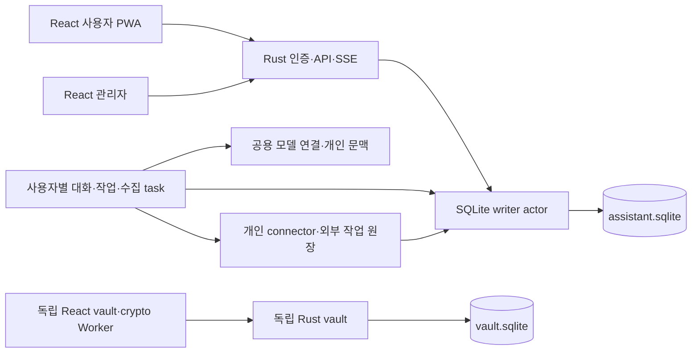

# 구현 설계

Rust 서버·에이전트·CLI, React/TypeScript 웹, SQLite가 최종 결정이다. 아래 구조는 최종 구현 목표다. 실행 가능한 account/store/server/CLI와 React의 현재 범위는 [개발 안내](development.md)에 둔다. 사용자 지시의 추적은 [requirements](requirements.md), 개별 동작은 [features](features.md), 근거는 [references](references.md)에 둔다.

## 언어와 배포 경계

| 대상 | 결정 |
| --- | --- |
| API·인증·하네스·도구·수집·CLI·이전 | 직접 작성하는 실행 로직은 Rust. Python/LangGraph/Node 서버를 유지하지 않음 |
| 사용자·관리자·볼트·PWA 화면 | React/TypeScript. CSS/HTML, TypeScript service worker, Vitest/Playwright 검증 |
| 볼트 암호 | 격리 Web Worker, 검증된 WebCrypto/Argon2 구현. Rust/WASM crypto library는 호환 시험 후 선택 가능; UI는 React |
| 기본 DB | bundled SQLite, 단일 호스트 local filesystem. PostgreSQL 지원은 후속 |
| 설치 | Linux x86_64/arm64 release binary에 React 정적 산출물 포함. optional vault binary. Node는 개발/빌드 시만 필요 |
| 선택 외부 프로그램 | gws native binary, 변경하지 않은 공식 Claude Code는 별도 연결 패키지. 설치 여부·의존성·지원 한계 표시 |
| 의존성 | SQLite C engine·TLS crypto의 C/ASM 등은 SBOM에 명시. 모든 dependency가 Rust라는 주장 없음 |

Rustls의 기본 crypto provider도 native 의존성을 포함할 수 있다. P0에서 cargo metadata/tree·build script·FFI·license·MSRV를 검사한다. Poppler/ffmpeg/PyTorch/Python Whisper를 숨겨서 필수 runtime으로 넣지 않는다. PDF는 Rust parser를 검증하고 음성/비전은 설정된 provider 또는 검증한 선택 local inference를 사용한다. 지원하지 않는 codec은 제한을 표시한다. 기본 LLM이 media를 지원하지 않으면 별도 media 연결이 필요하다.

## 목표 폴더

```text
apps/moosuri/                  # init/serve/doctor/backup/restore/migrate CLI
apps/moosuri-vault/            # 독립 vault service/CLI
crates/moosuri-core/           # IO 없는 ID·권한·상태 전이·도메인 계약
crates/moosuri-store/          # SQLite writer/repositories/journal/backup
crates/moosuri-agent/          # harness/context/memory/skills/tasks/scheduler
crates/moosuri-connectors/     # source protocol/Google/public/media/model adapters
crates/moosuri-server/         # auth/admin/API/SSE/static assets
crates/moosuri-vault/          # ciphertext API·nonce/envelope journal
crates/moosuri-vault-crypto/   # 선택 Rust/WASM crypto library, 먼저 spike
crates/moosuri-test-support/   # synthetic provider/clock/fault injection
web/app/                      # React 사용자 PWA
web/admin/                    # React 관리자 entry
web/vault/                    # 독립 React bundle/origin/Worker
web/shared/                   # UI tokens/components·DTO client, secret 없음
migrations/assistant/         # 새로운 SQLite baseline
migrations/vault/             # 독립 SQLite schema
fixtures/synthetic/           # 공개 가능한 합성 입력/정답/암호 벡터
assets/                       # 자체 branding·출처/권리 확인한 자산
deploy/                       # 일반 systemd/OCI/reverse-proxy 예제
community/skills/             # 공개 SKILL.md/합성 예제, 실행 코드는 별도 connector
openspec/                     # 정본 repo 규약 + 미구현 change deltas
tools/openspec/               # 기여용 고정 CLI·lock, 제품 runtime 아님
tools/xtask/                  # 현재는 계획 검증기만 구현
docs/                         # 설계와 현재 상태
audit/                        # 구 소스 경로·해시·이전 판정·시험 표면
```

빈 제품 crate를 미리 만들어 완료처럼 표시하지 않는다. memory/tasks/media 등은 module로 시작하고 별도 feature·OS·암호 경계가 있을 때 crate를 나눈다. `core ← store/connectors ← agent/server/CLI` 의존 방향을 유지한다. React는 생성 DTO/OpenAPI 계약으로 Rust와 연결하며 DB 타입·credential을 받지 않는다. vault는 agent/memory/tool에 의존하지 않는다.

## 단일 호스트 실행과 SQLite



`moosuri serve`는 하나의 감독된 Rust 프로세스다. API는 접수·조회만 하고 모델 루프는 독립 Tokio task 수명으로 실행한다. 대화·예약·수집·media·effects의 concurrency와 예산은 각각 제한한다. SQLite writer actor 한 곳에 변경을 보내고 read pool은 짧은 snapshot만 사용한다. vault는 별도 서비스/UID/DB/writer다. legacy의 여러 PG writer 프로세스를 그대로 옮기지 않는다. 미래 multi-host는 별도 설계다.

assistant DB 하나 안에 설치 설정·계정·사용자별 내용·usage를 함께 둔다. user마다 DB를 나누지 않아 요청/권한/예산/상태를 한 transaction에서 처리할 수 있다. 대신 모든 개인 FK·unique/index·repository에 `tenant_id`를 포함한다. SQLite에는 RLS가 없으므로 [계정 격리](accounts-isolation.md)의 API·파일·검색·비동기 회귀가 필수다. vault DB와의 변경은 단일 transaction처럼 취급하지 않고 아래 journal/outbox로 수렴한다.

연결마다 `foreign_keys=ON`, WAL, `synchronous=FULL`, bounded busy timeout을 적용한다. local filesystem만 사용한다. 변경은 짧은 `BEGIN IMMEDIATE`; 모델·HTTP·stream·KDF를 transaction 안에서 기다리지 않는다. 고정 whitelist 쿼리와 타입 검증을 쓴다. FTS5 normalization/부분 검색은 한국어 사례로 평가하며 pg_trgm과 같은 결과라고 가정하지 않는다.

| 이전 PG 기법 | SQLite 대체 |
| --- | --- |
| advisory lock·request lock | `(tenant_id,request_id)` unique + payload digest + writer transaction |
| FOR UPDATE / SKIP LOCKED | 조건부 UPDATE claim, revision/status/attempt CAS, 정확히1행 갱신 |
| 전역 owner epoch | tenant visibility/context/thread revision + account auth epoch |
| DB 프로세스 잠금 | 설치 lifetime OS lock + boot generation + supervisor drain |
| 별도 checkpoint writer | actor만 쓰는 typed checkpoint·pending call·receipt |
| pg_dump snapshot | SQLite online backup + snapshot watermark + 독립 최신 journal |

설치 lock을 얻고 boot ID를 기록한 뒤만 traffic을 받는다. 종료는 admission 중단→claim 중단→task/child drain→DB flush/close→lock 해제다. lease 만료만으로 이전 프로세스 종료를 추정하지 않는다. 자식 프로세스가 backend 죽음 뒤 살아남지 않도록 OS supervisor/cgroup 정리와 takeover 검증을 한다. 재시작한 dispatching effect는 조회만 가능한 `outcome_unknown`으로 다룬다.

자료 전달은 tenant delivery gate 아래 auth/visibility를 짧게 검사한 후 제한된 chunk를 enqueue한다. 삭제는 같은 gate의 write→writer transaction 순서다. writer actor가 gate를 기다리는 역순은 금지한다. 느린 stream은 bounded timeout/backpressure로 끊으며 DB transaction을 네트워크 동안 잡지 않는다. 이미 사용자에게 전달된 bytes를 회수할 수 있다는 보장은 하지 않는다. 철회 이후 새 전달·SSE replay·검색을 막는다.

## 하네스와 영속 실행

`Run`: `admitted → queued → running → waiting_input | waiting_effect | waiting_for_credential | paused | succeeded | failed | cancelled`.
`tenant_id, user_id, request_id, run_id, attempt, state_version, provider_version, model/effort, visibility_epoch, budget, checkpoint_seq`를 저장한다. 재시도는 같은 요청의 attempt를 갱신하고 steer는 원래 조건과 acceptance revision을 바꾼다. 재시도 버튼이 composer를 덮어쓰지 않는다.

한 step은 `PrepareModel → ModelResult → PlanToolCalls → ToolResults → Publish/Continue`다. 다음 IO 전에 의도를 저장하고 실제 call ID에 결과/영수증을 묶는다. 성공 checkpoint와 최종 발행 사이에 죽으면 저장된 결과로 마무리한다. 완료 도구를 다시 실행하지 않는다. 원문 의존 관계·tenant·attempt·취소·정정·삭제·task acceptance를 모든 commit에서 확인한다.

Rig의 serializable sans-IO AgentRun은 후보 내부 driver다. 이미 내구성 API가 있으므로 기능이 없다고 단정하지 않는다. P0에서 pending tool 재개·중복 ID·취소·완료 발행 gap·삭제·외부 영수증을 시험한다. 앱의 journal·권한·예산·receipt를 보존하지 못하면 작은 자체 driver를 쓴다. 외부 API 호출이 있는 loop 전체를 임의 재실행하지 않는다. LangGraph checkpoint blob을 역직렬화해 새 엔진에서 실행하지 않는다.

독립 읽기는 bounded concurrency, 같은 객체 쓰기는 revision/CAS다. LLM turns·tool calls·bytes·time·token·retry 각각 상한을 둔다. Tokio cancel은 외부 취소 증거가 아니다. HTTP pool은 `Arc<Client>`로 안전하게 재사용하며 각 요청의 종료가 다른 요청의 transport를 닫지 않는다. metadata-only latency를 queue/context/model/tool/first-final-body/total로 나눠 측정한다.

## 외부 작업과 권한

`Effect`: `prepared → adopted → dispatching → succeeded | failed | outcome_unknown`.
원래 사용자 명령·tenant·대상 revision·provider binding·tool call·실제 committed checkpoint·payload digest·영수증을 연결한다. 로컬 문서/기억 쓰기는 mutation과 local receipt를 같은 transaction으로 저장한다. provider idempotency가 있으면 같은 ID를 쓰고, 없으면 marker/readback을 쓴다. 응답 유실을 새 ID의 재발송으로 해결하지 않는다. 보편적인 exactly-once 보장은 하지 않는다.

권한은 내부 검증이다. 명확한 요청·정상 조회/기억/저장·이미 지정한 외부 작업마다 승인 팝업을 붙이지 않는다. 실제로 모르는 대상·수신인·시각만 묻는다. 원문·메일·스킬·모델 출력은 새로운 권한을 만들지 않는다. default shell/MCP/plugin 자동 설치는 없다. 사용자가 원하는 새 작업은 검증된 도구 조합이면 학습하고, 없는 provider 연결은 실제 개발 전까지 미지원으로 표시한다.

credential은 [볼트 연결 설계](credential-use.md)의 opaque user/service binding으로 선택한다. 이미 연결된 계정은 원래 요청 범위에서 자동 재사용한다. 실제 인증은 신뢰한 사용자 기기의 typed broker가 수행하고 secret/TOTP를 모델에 돌려주지 않는다. operation/resource/recipient·exact origin·version을 확인하며 잠금/offline이면 슬롯을 반환하고 같은 run/effect로 대기·재개한다. adopted effect는 broker identity/generation에 고정하며 다른 기기로 자동 failover하지 않는다. 발송 가능성이 있으면 원래 journal로 reconcile하거나 outcome_unknown을 유지한다. 신뢰한 기기의 local grant가 최대 허용 범위이며, 새 dispatch commitment와 철회를 서버 writer에서 순서화한다. 비밀 비노출과 악성 서버의 작업 의도 위조 방어는 구별한다. 상세 경계는 연결 설계가 정본이다. 별도 server token 선택은 user-key vault와 다른 신뢰 경계다.

## 자료·기억·스킬·일

자료는 tenant/binding/dataset/scope/source identity/version/speaker/observed_at/valid_at로 식별한다. batch commit 뒤 cursor 진행, lost ACK replay no-op, complete snapshot만 retire를 허용한다. 원문 해제의 keep/delete·기억 망각·대화 삭제를 구별한다. epoch/tombstone은 검색·FTS·캐시·checkpoint·SSE·문서에 적용된다.

현재 사실·요청 관련 근거·오래된 대화/문서·작업 상태를 분리한다. 시간·화자·사용자 범위를 먼저 제한하고 한국어 normalization/FTS5/substring을 평가한다. 임베딩은 실제 품질 필요가 확인될 때 선택하며 외부 전송을 몰래 추가하지 않는다. 추출은 검증된 원문 발화/인용/시간만 사용하고 changed/accessed 우선·일일 예산을 둔다. 화자 불명 통화는 자동 기억 제외다. 정정은 최신 revision, 망각은 재추출 tombstone이다. 모든 의미상 바꿔말하기 차단을 보장하지 않는다.

ToolRegistry는 schema/version·capability·read/write/effect·output bound·timeout·error taxonomy를 갖는다. 필요한 metadata/schema만 읽고 discovery receipt도 재개 가능하게 저장한다. 공용 절차 catalog는 공개 자료로 다시 작성하고 개인 학습 절차는 tenant에 귀속한다. 기존9도구·8단계 route를 parity 기준으로, 서로 다른 유효 입력2회의 finalized 성공 후 확장 route 활성화, 귀속 가능한 실패3회/schema drift/사용자 edit/delete 무효화를 유지한다. infrastructure/cancel/empty 결과를 잘못된 학습 실패로 세지 않는다. matcher work budget4,096 또는 검증한 동등 상한을 둔다.

GitHub의 공개 스킬은 [community-skills](community-skills.md)에 따라 SKILL.md와 최소 capability metadata로 배포한다. catalog는 공개 데이터만 받아 로컬에서 순위를 매기고 기존 제안/할 수 있는 일 카드로 설치·연결·실행한다. 공용 immutable bytes와 개인별 enabled/version/proof를 분리한다. v1은 community scripts/hooks/의존성 설치를 실행하지 않으며 스킬이 adapter/credential 권한을 새로 만들지 않는다.

Task는 원래 조건·plan·acceptance revision·예산·산출물·검증을 보존한다. 최대2회 repair도 같은 예산이다. 소진은 완료가 아니며 사용자가 요청한 추가 범위만 확장한다. obligation은 요청/약속/회신 대기/해결/취소·부분 완료·위임·mute/snooze를 구별한다.

## 예약·소식·푸시

SQLite due 조회는 약5초, idle LLM 호출0. 인프로세스 notify는 wakeup 보조이며 DB가 정본이다. `(tenant_id,schedule_id,scheduled_for)` unique와 사용자 manifest로 회차를 정한다. UTC 실행시각과 원래 local rule·IANA timezone·schedule revision을 함께 저장한다. 일회/일/주/간격·최소60초를 지원하며 실행 의미는 아래 표로 고정한다. 같은 예약은 진행1개+최신 대기1개로 합친다. 사용자별 공정 큐와 공유/개인 예산을 모두 지킨다.

예약 생성/변경 화면은 해석한 규칙과 다음 실행시각을 보여준다. 명확한 자연어 요청에 추가 확인 버튼을 강제하지 않는다. 모호한 시각만 묻는다.

| 경우 | v1 정책·검증 가능한 결과 |
| --- | --- |
| 매일/매주 | 생성 때 선택한 IANA timezone의 wall-clock 규칙. 사용자 기본 timezone 변경으로 기존 예약을 몰래 이동하지 않음 |
| 간격 | 저장한 UTC anchor+n×duration. 실행 완료 시각 기준으로 다음 회차를 밀지 않음 |
| DST gap | 존재하지 않는 반복 local 시각은 그 회차를 skipped로 기록하고 다음 유효 회차로 진행. 일회 입력이면 유효 시각을 다시 선택 |
| DST fold | 반복 local 시각은 첫 번째 offset에서1회만 실행. 일회는 첫 offset을 기본 표시하되 명시한 offset을 존중 |
| 중단 중 놓친 반복 | 아직 유효한 누락 회차 중 가장 최근1개만 delayed로 실행/queue. 오래된 회차는 skipped로 기록하며 쌓아서 재생하지 않음 |
| 중단 중 놓친 일회 | 원래 authority/valid_until이 유효한 일반 읽기·내부 작업은 복귀 후1회 delayed 실행. 만료면 expired; 생성 시 이미 지난 일회 시각은 새 시각 또는 즉시 실행으로 해석을 바로잡음 |
| 고정 외부 발송 | 원래 고정 수신인/본문·같은 occurrence/effect. 예정 시각 이후5분 이내만 새 dispatch 가능하며 초과면 expired. 일반 미실행 catch-up 정책보다 우선 |
| pause/resume | pause는 새 회차 접수와 다음 dispatch를 막고 아직 시작하지 않은 queue를 skipped로 처리. 진행 run은 안전한 checkpoint에서 paused, 이미 committed effect는 reconcile. resume는 그 run을 유효 조건으로 재개하고 다음 미래 회차부터 예약하며 pause 기간은 catch-up하지 않음 |
| 규칙/대상 변경 | revision을 올리고 이전 revision의 미실행/claimed 회차를 fence. 다음 미래 회차만 새 규칙으로 생성. 과거 회차를 새 ID로 되살리지 않으며 늦은 결과는 발행 금지·기존 외부 영수증은 보존 |
| 복원 | 일반 restart와 구분. 기존 복원 quarantine 규칙이 우선하며 예약/외부 작업을 자동 재생하지 않음 |

claim만으로 실행 권한이 생기지 않는다. 같은 writer transaction이 현재 schedule/account revision과 pause를 확인하고 dispatch commitment를 저장한다. pause/edit가 먼저면 새 commitment를 거절하고 commitment가 먼저면 in-flight로 기록해 이미 시작한 효과를 취소됐다고 말하지 않는다. 같은 scheduled_for의 unique identity는 revision 변경에도 중복 회차를 허용하지 않는다. timezone database 버전을 기록하고 업데이트 때 미실행 미래시각만 다시 계산하며 완료 회차는 바꾸지 않는다.

always/changes 알림은 검증된 동등 관측만 생략한다. 첫 회·변경·실패·불명은 알린다. 이전 artifact는 비교 fence로 읽고 provenance 연쇄를 부풀리지 않는다. Push는 본문 없는 일반 안내+opaque ID, 인증 후 조회다. 조용한 시간·멀티탭·만료 endpoint·계정 전환·초안 보존을 검증한다. 브라우저 permission은 필요한 사용자 gesture에서 요청한다.

## 웹·볼트

기본 진입은 마지막 개인 채팅이다. 뮤즈 중심의 간결한 흐름과 피클/그록봇의 보조 UX를 참조하되 공개 자산·카피는 자체 제작한다. 넓은 작업 영역, 하단 safe area, 독립 scroll, IME, mobile keyboard/viewport, focus/ARIA/reduced-motion을 계약으로 둔다. 사진은 composer/말풍선/보관함에서 미리보기, 업로드 중 다른 전송 허용, 녹음 pause/resume/미리듣기/텍스트 수정 흐름을 유지한다.

SSE는 tenant/run/attempt/seq·auth generation으로 검사한다. React state/query/worker/object URL은 account switch에 정리하며 늦은 결과를 차단한다. service worker는 공개 shell만 캐시하고 private API·메시지·이미지·키는 캐시하지 않는다. offline 상태는 분명히 표시하고 개인 메시지를 몰래 offline queue에 저장하지 않는다.

볼트는 독립 origin·binary·UID·DB·cookie·journal·React bundle·crypto Worker다. master/recovery key는 사용자만 가진다. 로그인 재설정이 복호화키를 재설정하지 않는다. 관리자 DB/source 열람 방어와 악성 서버 JS의 차이, 기존 암호문 호환, TOTP/CSV/rotation/복원은 [vault-security](vault-security.md)에 명시한다.

## 백업·복원·전환

새 SQLite baseline과 legacy PG import를 분리한다. 원본23개 migration은 동작 증거로만 읽는다. 관계·ID·revision·receipt·tombstone mapping을 기록하고 진행 중인 LangGraph 실행은 변환 재생하지 않는다.

삭제/disable/auth generation은 최소 opaque 독립 journal에 append+fsync한 후 DB에 적용한다. crash gap은 readiness 전에 replay한다. WAL은 이 journal의 대체물이 아니다. vault 계정 정지/삭제는 assistant auth journal→idempotent outbox→vault 자체 journal/epoch 갱신으로 전달하고 ACK 전 pending 상태를 보인다. vault는 정상 API 요청마다 짧은 내부 auth/introspection으로 계정 상태를 확인하고 연락 불가 시 새 요청을 차단한다. 로컬에 이미 복호화된 사용자의 기억/clipboard를 원격 삭제한다고 약속하지 않는다.

백업 단위는 SQLite와 **그 snapshot이 참조하는 필수 파일**이다. 원본 첨부·사진/PDF·DB 밖에 저장한 사용자 산출물은 immutable blob으로 다룬다. 파일을 staging에서 hash/size 확인·fsync·atomic publish한 뒤에만 DB 참조를 commit한다. 중간 실패로 남은 미참조 blob은 GC 대상이며 DB가 없는 bytes를 완성된 첨부로 가리키지 않는다.

첫 backup은 writer fence에서 SQLite online backup·watermark와 `tenant/blob ID, reference revision, SHA256, size, storage format` manifest 및 durable backup pin을 같은 시점으로 확정한다. manifest는 snapshot에서 유도하며 현재 live DB를 나중에 조회해 섞지 않는다. fence를 풀고 pinned blobs를 복사·검증·암호화한다. blob GC는 활성 pin을 존중하고 backup 성공/실패가 확정되기 전 pin을 해제하지 않는다. 중단된 backup도 복구 시 상태를 확인한 뒤 정리한다. 외부 파일 복사 동안 DB lock을 잡지 않으며 bounded snapshot 시간이 넘으면 backup busy다.

필수 bytes·snapshot·manifest를 모두 검증한 뒤에만 complete archive로 게시한다. 재생성 가능한 thumbnail/FTS cache·공개 skill cache·임시 upload는 제외하고 rebuild 표시를 남긴다. model/connector credential은 기존 재등록 경계를 따르며 이 manifest로 vault master나 기기 비밀을 서버 백업에 끌어오지 않는다. archive/manifest도 암호화하고 독립 최신 journal/head는 snapshot과 별도로 보관한다. live .db 단독 복사·WAL/SHM 삭제로 백업하지 않는다.

### 백업 복구 키의 소유와 수명

백업의 outer encryption은 **설치 운영자가 보관하는 별도 복구 키**를 사용한다. 사용자 vault master/recovery key, 앱 로그인 비밀번호, provider token과 다른 키다. assistant와 vault backup은 purpose/key ID를 분리하고 하나의 운영자 복구 묶음으로 내보낼 수 있다. vault backup의 outer key로 얻는 것은 기존 vault ciphertext뿐이며 사용자 비밀을 복호화하지 못한다.

v1은 공개 recipient로 암호화하고 private identity로 복원하는 표준 age 형식과 Rust `age` library를 후보로 한다. P0에서 사용할 version/feature·상호운용·MSRV·보안 권고를 고정 검증한다. 암호 primitive나 자체 archive cipher를 만들지 않으며 외부 Go/age CLI 설치를 기본 runtime으로 요구하지 않는다. 자세한 근거는 [references](references.md)에 둔다.

첫 backup setup에서 기존 public recipient를 등록하거나 제한된 setup 세션이 생성한 키를 운영자에게 한 번 내보낸다. private identity는 서버 DB/config·같은 암호화 archive·Git·로그에 저장하지 않는다. 생성 직후에는 export/작은 합성 암호문 검증에만 잠깐 사용하고 세션 종료 때 폐기한다. 운영자는 복구 묶음을 원래 서버 밖에 보관한다. 별도 복사본을 다시 입력해 작은 합성 archive를 해독하는 setup 검사가 끝나야 자동 backup을 활성화한다. 단순 다운로드 성공을 실제 off-host 복원 성공이라고 표시하지 않는다. 설정을 건너뛰면 backup은 unconfigured이며 일반 앱 설치/대화는 계속된다.

| 복원 입력 | 서버 상실 이후의 출처와 역할 |
| --- | --- |
| encrypted archive와 key ID | 독립 backup 대상/운영자 보관본. header의 ID는 키 선택 힌트이며 해독 후 manifest의 purpose/ID와 대조 |
| 해당 epoch의 private backup identity | 운영자가 서버 밖에 보관한 복구 묶음 또는 독립 보관소. 복원 대상 moosuri vault만을 유일한 보관소로 쓰지 않음 |
| 최신 독립 journal/head | snapshot과 별도로 보존·갱신한 recovery 자료. 오래된 recovery-kit 안의 head를 최신이라고 대신 사용하지 않음 |
| journal 검증 자료 | 선택한 journal 형식의 installation ID·format·trust anchor/검증 key. 필요한 비밀이 있다면 별도 복구 묶음에 보존하고 기존 호스트 config에만 두지 않음 |
| backup 대상 접근 수단 | 운영자가 원래 moosuri 서버/볼트 없이 접근 가능한 계정·복구 수단 또는 내려받은 사본. target 로그인 자체의 순환 의존을 만들지 않음 |
| 사용자 vault master/recovery | outer 복원 후 개인 vault unlock에만 필요. 운영자 backup 복구 묶음에 개인 키를 수집하지 않음 |

평상시 backup writer는 public recipients만으로 archive/journal segment를 암호화한다. private identity를 매번 다시 입력할 필요가 없다. 복원은 private 로컬 CLI의 제한된 파일/FD에서 필요한 키를 읽고 staging 해독 뒤 메모리/임시 비밀을 정리한다. 키 값은 argv/stdout/진단/agent context로 보내지 않는다. key가 없으면 `backup_key_missing`, 잘못된 key/변조로 해독할 수 없으면 `backup_decryption_failed`로 멈추며 plain backup이나 vault master 대용으로 우회하지 않는다.

키 교체는 새 identity의 export/setup 검증→active public recipient/key ID 전환 순서다. 각 archive와 암호화 journal segment는 그 epoch를 기록한다. 남아 있는 과거 backup/필수 journal을 해독하는 old identity는 보관 기간 동안 유지한다. 옛 자료를 검증한 새 키로 재암호화하거나 해당 archive와 복구에 필요한 journal의 보관 수명이 모두 끝난 뒤에만 폐기한다. 새 키 등록으로 과거 archive가 자동 해독 가능해졌다고 가정하지 않는다.

### 복원 검사와 활성화

복원은 **빈 data_dir**에서 snapshot과 모든 필수 blob의 hash/size/소유권·참조를 검증한다. 누락/변조는 recovery_required이며 DB integrity/FK만으로 성공 처리하지 않는다. 최신 삭제 journal을 적용한 뒤만 접근을 열어 백업 도중 삭제한 자료도 되살리지 않는다. 과거 암호화 archive에 bytes가 남을 수 있는 보관 수명과 현재 서비스의 삭제를 구분한다. 합성 이미지/PDF의 실제 읽기·preview 재생성까지 P7/P9에서 확인한다.

복원은 독립 private 경로→forward migration→최신 journal→integrity/FK/manifest 대조→세션/초대 폐기·작업/effects/media 격리→읽기 검증→활성화다. 삭제/정지 계정은 최신 journal로 유지한다. snapshot의 옛 password hash/role/provider version은 최신 auth epoch만 적용해도 안전해지지 않으므로 복원 후 인증·권한·provider를 recovery_required로 잠그고 아래 재등록 기준을 따른다. 사용량은 snapshot 시점의 하한일 뿐이며 최신이라고 주장하지 않는다. 외부 예약 발송을 자동 재생하지 않는다. 최신 journal이나 staged vault key 상태가 불명확하면 recovery_required다. 기존 수집기·cron은 verified cutover 전까지 그대로 둔다.


복원 v1은 과거 password hash를 새 로그인에도 사용하지 않는다. 서버의 private 로컬 recovery CLI로 operator가 복구 admin 한 명의 현재 역할과 새 credential을 명시적으로 설정하고 기록한다. 나머지 계정은 정지/삭제 journal을 먼저 적용한 상태에서 새 임시 credential/강제 변경으로 재등록하며 옛 admin role은 자동 복구하지 않는다. provider/API/OAuth binding도 기본 disabled이며 현재 정책·credential을 다시 등록한 뒤 새 작업의 dispatch를 연다. 재등록만으로 복원된 미완료 run/effect의 quarantine이 자동 해제되지는 않는다. 기존 vault master/recovery key는 이 절차로 바뀌거나 해독되지 않는다. 일반 재시작에는 이 복원 절차를 요구하지 않는다.

복원 v1은 별도 최신 usage ledger를 구현했다고 가정하지 않는다. snapshot 이후 영향을 받을 수 있는 개인/공용 billing period를 accounting_unknown으로 표시하고 남은 예산을0으로 취급해 새 유료 dispatch를 차단한다. snapshot의 정산/미완료 reservation은 보수적 하한으로 보존하며 timeout을 환불하지 않는다. provider 영수증/청구와 독립 보존한 accounting evidence로 reconcile할 수 있을 때만 unknown을 해소한다. 정확한 개인 귀속을 복구할 수 없으면 관리자가 명시한 보수적 조정 또는 별도 신규 예산으로 앞으로의 작업만 허용하며 옛 불명을 지우지 않는다. 과거 금액을0으로 만들거나 실제 지출을 완벽히 복구했다고 말하지 않는다. snapshot→password reset/demotion/provider revoke/charge→restore 및 in-flight reservation kill 시험이 P9 필수다.
